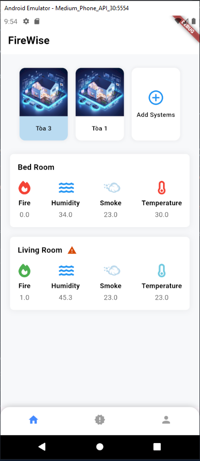
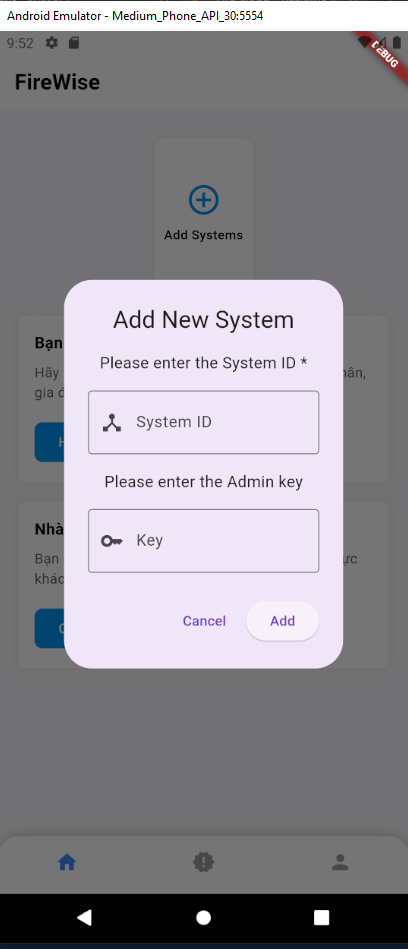
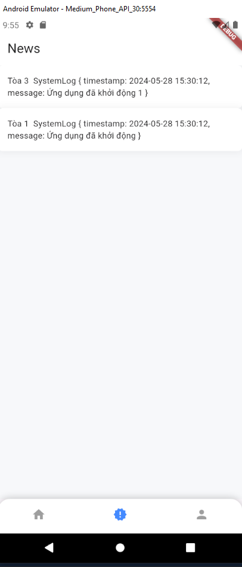

# FireWise Tech: mobile app

This branch holds the Flutter app of the FireWise Tech fire-risk alert system (IoT Challenge 2024). See the [`main` branch](https://github.com/Eggien14/FireWiseTech_IoTc2024) for the whole system and the other branches.

## Features

- Sign up and sign in with Firebase Authentication.
- Add a gateway ("system") by its ID and admin key, or by scanning its QR code.
- See every sensor node (room) of a system with its flame, smoke, temperature and humidity readings, and rename nodes.
- Read the event log written by the gateway (network opened, risk level 1, 2 or 3).
- Notifications and a profile page.

<p>
  
  
  
</p>

## Code layout

| Path | Role |
|---|---|
| `lib/main.dart` | App entry, Firebase initialisation |
| `lib/screen/` | Welcome, login, register, home, my systems, news (event log), profile |
| `lib/services/` | Firebase Authentication, Realtime Database, Storage and notifications |
| `lib/models/` | Users, devices, system log |
| `lib/widgets/`, `lib/Layout/` | Dashboard cards, charts, buttons, page layout |

## Build

1. Install Flutter (Dart SDK 3.3 or newer) and Android Studio.
2. Create a Firebase project with Authentication, Realtime Database and Storage, add an Android app with the package name `com.example.iot_app`, and download its `google-services.json` into `android/app/`. This file is not in the repository (it is git-ignored); use the same project as the gateway.
3. Run:

   ```bash
   flutter pub get
   flutter run
   ```
